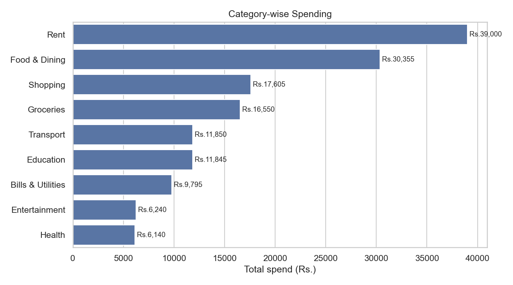
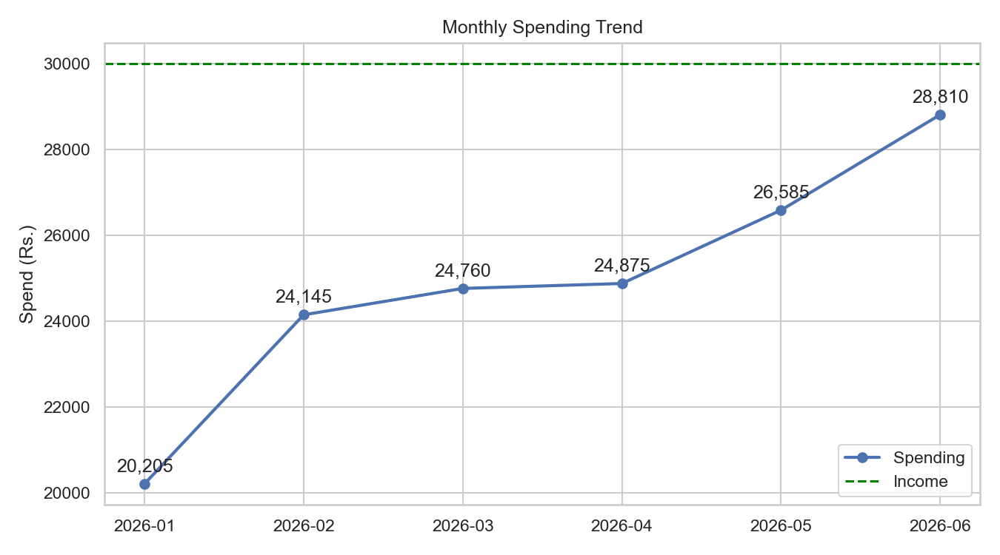
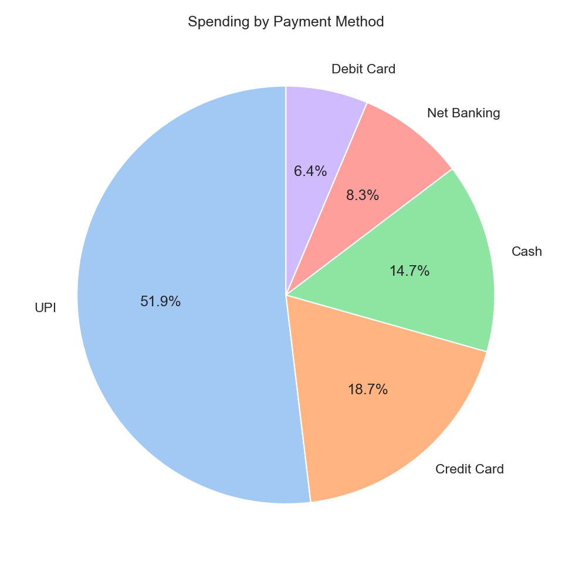
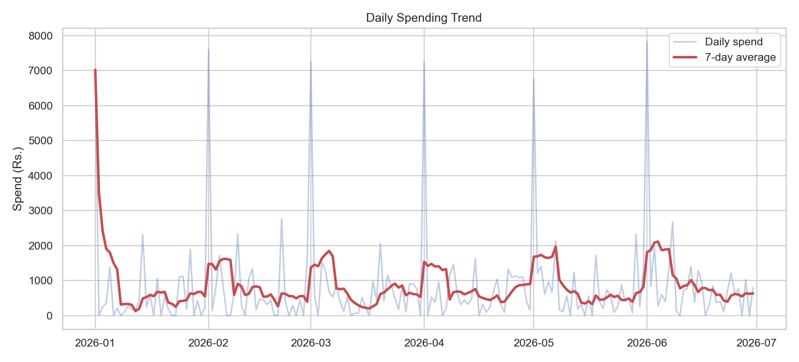
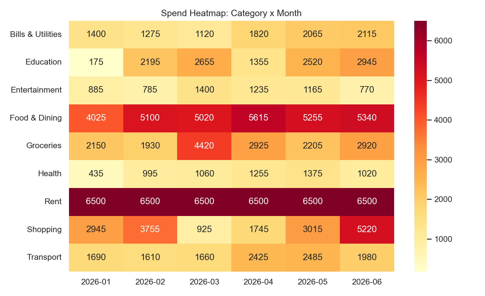

# 💸 Personal Expense Tracker with Data Visualization

> A Python expense-analysis project that cleans transaction data, stores results in SQLite, visualizes spending patterns, checks category budgets, and produces reports. An interactive Streamlit dashboard is included.

---

## 👨‍💻 Author

**Adarsh Srivastav**  
Computer Science and Engineering (CSE) Student  
Python | Data Analysis | Data Visualization

---

## 📌 Project Overview

The **Personal Expense Tracker with Data Visualization** turns expense records into useful financial insights. It accepts a CSV file or synthetic sample data, normalizes inconsistent records, calculates spending summaries, and creates charts and reports.

The optional Streamlit dashboard adds CSV upload, manual expense entry, a reporting-period filter, KPI cards, budget status, and transaction review. No bank connection or real financial information is required.

> **Project note:** The included dataset is synthetic. Expenses entered manually in the dashboard are kept in the current Streamlit session; they are not written to the CSV or SQLite database.

---

## 🎯 Objectives

- Load expense records from a CSV file or generate reproducible synthetic data.
- Normalize dates, categories, payment methods, and notes.
- Remove invalid amounts and duplicate rows.
- Store cleaned results in SQLite.
- Analyze spending by category, month, day, and payment method.
- Compare category spending with configured monthly budgets.
- Generate charts, summary CSVs, and a text report.
- Present the results in an interactive dashboard.
- Keep the code modular, testable, and suitable for a student portfolio.

---

## ✨ Key Features

- Six months of reproducible synthetic transactions with deliberate data-quality issues.
- CSV input with required columns: `date`, `category`, `amount`, `payment_method`, and `note`.
- Mixed date-format parsing and category/payment-method normalization.
- Keyword-based category guesses for transactions with a missing category.
- Invalid amount and duplicate-row handling with a cleaning log.
- SQLite persistence for the cleaned CLI pipeline.
- Category, monthly, payment-method, daily, savings, and budget analysis.
- Five saved visualizations: category bar chart, monthly line chart, payment-method chart, daily trend, and category-month heatmap.
- CSV summaries and a plain-text expense report.
- Streamlit dashboard with CSV upload, session-based manual entries, reporting-period filter, KPIs, charts, budget checks, and transaction review.
- Light and dark dashboard themes.
- Pytest coverage for date parsing, category guessing, invalid rows, and duplicates.

---

## 🏗️ System Architecture

```text
CSV / Synthetic data
        │
        ▼
  data_loader.py
        │
        ▼
   cleaning.py ───────────────► Cleaning log
        │
        ├────────► database.py ─────────► data/expenses.db
        │
        ▼
    analysis.py
        │
        ├────────► visualize.py ────────► images/*.png
        │
        └────────► report.py ───────────► outputs/*.csv
                                          reports/*.txt

main.py runs the complete CLI pipeline.
app.py provides an interactive Streamlit dashboard.
```

### Data Flow

```text
Enter or load expenses
        ↓
Validate required columns
        ↓
Parse dates and normalize fields
        ↓
Drop invalid amounts and duplicate records
        ↓
Save cleaned data to SQLite and CSV
        ↓
Calculate summaries and budget status
        ↓
Create charts, reports, and dashboard views
```

---

## 🔄 Working Principle

1. **Load:** Read `data/expenses_raw.csv`, another supplied CSV, or generated sample data.
2. **Clean:** Parse ISO and `DD/MM/YYYY` dates, normalize categories and payment methods, infer missing categories from note keywords, and remove invalid amounts and duplicate rows.
3. **Store:** Save the cleaned dataset to `data/expenses.db` in the CLI pipeline.
4. **Analyze:** Group valid expenses by category, month, payment method, and date.
5. **Compare:** Check monthly category totals against the budgets configured in `src/config.py`.
6. **Visualize:** Save five charts under `images/` and display interactive charts in Streamlit.
7. **Report:** Export summary CSV files and a plain-text report.

### Main Calculations

```text
Daily average     = total spend / calendar days in the selected date span
Monthly savings   = configured monthly income - monthly expenses
Budget difference = category-month spend - configured category budget
```

Savings are estimates based on `MONTHLY_INCOME` in `src/config.py`; they are not inferred from bank or income transactions.

---

## 🧾 Expense Data Format

CSV files must contain these columns:

| Column | Description | Example |
|---|---|---|
| `date` | Transaction date (`YYYY-MM-DD` or `DD/MM/YYYY`) | `2026-01-05` |
| `category` | Expense category; can be blank for keyword guessing | `Food & Dining` |
| `amount` | Positive expense amount | `250.00` |
| `payment_method` | How the expense was paid | `UPI` |
| `note` | Short description used for context and category guessing | `Cafe coffee` |

Example:

```csv
date,category,amount,payment_method,note
2026-01-05,Food & Dining,250,UPI,Cafe coffee
06/01/2026,,180,Cash,Uber ride
```

---

## 💻 Software and Tools

- **Language:** Python
- **Data handling:** Pandas, NumPy
- **Visualization:** Matplotlib, Seaborn, Streamlit charts
- **Storage:** SQLite (`sqlite3`)
- **Testing:** pytest
- **Dashboard:** Streamlit
- **Version control:** Git and GitHub

---

## 📊 Dashboard and Visualizations

The dashboard offers:

- Total spending, daily average, transaction count, and top category.
- A reporting-period filter for all available months or one month.
- Category and payment-method spending comparisons.
- Monthly and daily spending trends.
- A seven-day rolling average on the daily chart.
- Budget status and a sortable budget table.
- A transaction review table.
- CSV upload and session-based manual expense entry.

### Generated Charts

| Category spending | Monthly trend |
|---|---|
|  |  |

| Payment methods | Daily spending |
|---|---|
|  |  |

### Category-by-Month Heatmap



---

## 🧪 Testing

Run the test suite with:

```bash
python -m pytest -q
```

The current tests cover:

| Area | Validation |
|---|---|
| Date parsing | ISO and day/month/year formats |
| Category inference | Keyword-based guessing from notes |
| Data cleaning | Invalid amounts, missing categories, and duplicate rows |

---

## 📁 Project Structure

```text
Personal Expense Tracker with Data Visualization/
│
├── .streamlit/
│   └── config.toml              # Dashboard themes
├── data/
│   ├── expenses_raw.csv         # Input / synthetic data
│   ├── expenses_clean.csv       # Cleaned export
│   └── expenses.db              # SQLite output (ignored by Git)
├── docs/
│   └── PROJECT_GUIDE.md         # Extended project and interview guide
├── images/                      # Generated chart images
├── notebooks/                   # Optional exploration workspace
├── outputs/                     # Analysis summary CSVs
├── reports/
│   └── expense_report.txt       # Generated text report
├── src/
│   ├── analysis.py              # Spending metrics and summaries
│   ├── cleaning.py              # Data normalization and validation
│   ├── config.py                # Paths, budgets, income, and rules
│   ├── data_loader.py           # CSV loading and manual-row helper
│   ├── database.py              # SQLite persistence
│   ├── generate_data.py         # Synthetic dataset generator
│   ├── report.py                # CSV and text report generation
│   └── visualize.py             # Saved Matplotlib/Seaborn charts
├── tests/
│   └── test_cleaning.py         # Data-cleaning tests
├── app.py                       # Streamlit dashboard
├── main.py                      # CLI pipeline entry point
├── requirements.txt
└── README.md
```

---

## 🛠️ Installation

Use Python 3.10 or newer for the full dashboard setup.

### Windows

```powershell
python -m venv .venv
.venv\Scripts\activate
python -m pip install -r requirements.txt
```

### macOS / Linux

```bash
python3 -m venv .venv
source .venv/bin/activate
python -m pip install -r requirements.txt
```

---

## ▶️ How to Run

### Run the complete analysis pipeline

```bash
python main.py
```

### Regenerate the synthetic dataset

```bash
python main.py --regenerate
```

### Analyze your own CSV

```bash
python main.py --csv path/to/your_expenses.csv
```

Use the required CSV columns listed above.

### Launch the dashboard

```bash
streamlit run app.py
```

Streamlit prints the local URL in the terminal. Use the dashboard’s sidebar to upload a CSV, add an expense for the current session, or filter by reporting period. Uploaded data and manual entries are not persisted to the project database.

---

## 📈 Sample Results

Running the included generator and pipeline produced:

```text
Raw rows loaded             : 328
Invalid amounts dropped     : 5
Missing categories inferred : 5
Duplicate rows removed      : 5
Clean rows                  : 318
Total spend                 : Rs.149,380
Average daily spend         : Rs.825
Highest category            : Rent
Highest-spend month         : 2026-06
```

Example insights from the generated dataset:

- Rent is the highest-spend category.
- UPI accounts for the largest share of spending by payment method.
- Seventeen category-month totals exceed their configured budgets in the sample run.

These are sample-data results; your own CSV will produce different values.

### Generated Outputs

| Location | Contents |
|---|---|
| `data/expenses_clean.csv` | Cleaned transaction data |
| `data/expenses.db` | SQLite table containing cleaned data |
| `outputs/category_summary.csv` | Totals and transaction counts by category |
| `outputs/monthly_summary.csv` | Monthly spend, income estimate, and savings estimate |
| `outputs/payment_summary.csv` | Totals by payment method |
| `outputs/budget_check.csv` | Monthly category budget comparison |
| `images/` | Five generated charts |
| `reports/expense_report.txt` | Summary, cleaning log, and insights |

---

## 🌍 Applications

The project’s data workflow can be adapted for:

- Personal and student budgeting
- Household spending reviews
- Freelancer expense summaries
- Small-business expense reporting
- Reimbursement preparation
- Introductory finance and data-analysis demonstrations

---

## ✅ Advantages

- Runs without access to banking APIs or real financial data.
- Reproducible sample data makes the project easy to demonstrate.
- Separates loading, cleaning, analysis, visualization, and reporting.
- Combines a command-line workflow with an optional interactive dashboard.
- Stores cleaned pipeline output in a lightweight SQLite database.
- Includes automated tests and generated reports.

---

## ⚠️ Limitations

- The sample dataset is synthetic and should not be treated as financial advice.
- Expenses must be entered manually or imported from a CSV; no bank integration is included.
- Dashboard manual entries last only for the current Streamlit session.
- Uploaded dashboard CSV data is not saved to SQLite.
- Category inference is rule-based and may need correction for unfamiliar descriptions.
- Duplicate removal can remove two legitimate purchases if every field is identical.
- Income and savings estimates rely on the configured monthly income value.
- Budgets and currency are configured in `src/config.py`.

---

## 🚀 Future Scope

- Persist dashboard-entered and uploaded transactions.
- Add editable categories and budget settings.
- Support recurring transaction detection.
- Add account and multi-currency support.
- Improve merchant/category matching with user feedback.
- Export a selected month to Excel or PDF.
- Add configurable alerts for budget limits.
- Deploy the dashboard for secure personal use.

---

## 🎓 Skills Demonstrated

### Python and Data Engineering

- Modular Python design
- CSV ingestion and data validation
- Date parsing and data normalization
- SQLite persistence

### Data Analysis and Visualization

- Pandas grouping and aggregation
- Category and monthly spending analysis
- Budget comparisons and savings estimates
- Matplotlib and Seaborn chart generation
- Dashboard storytelling with Streamlit

### Software Development

- Unit testing with pytest
- CLI argument handling
- Documentation and reproducible setup
- Git/GitHub project organization

---

## 💼 Industry Relevance

Personal finance and business reporting systems commonly transform raw transaction records into normalized, queryable data and decision-support summaries. This project demonstrates a small-scale version of that workflow:

```text
Data ingestion
      ↓
Cleaning and validation
      ↓
Storage
      ↓
Analysis and budget checks
      ↓
Visual reporting
      ↓
Insights for decision-making
```

The same foundational skills apply to Python development, data analysis, business analysis, reporting automation, and finance-related software.

---

## 📚 Additional Documentation

- [Project guide](docs/PROJECT_GUIDE.md) — architecture, implementation phases, GitHub guidance, simulation, and interview preparation.
- [Streamlit dashboard](app.py)
- [CLI pipeline](main.py)

---

## 🔬 Project Status

### ✅ Functional student project

The CLI pipeline, generated reports and charts, SQLite output, tests, and Streamlit dashboard are implemented. The included sample data is synthetic, and no real banking integration is present.

---

## ⭐ Conclusion

The **Personal Expense Tracker with Data Visualization** demonstrates how Python can transform messy expense records into cleaned data, useful summaries, visual trends, budget checks, and a shareable report. Its modular structure makes it suitable for learning and for future extensions such as persistent dashboard entry, improved categorization, and additional export formats.

## ⭐ Project Highlights

```text
Python + Pandas + NumPy
CSV ingestion and data cleaning
SQLite persistence
Category, monthly, payment, and daily analysis
Budget checks and savings estimates
Five generated visualizations
Streamlit dashboard with light/dark themes
CSV and text report exports
Pytest coverage
Synthetic data only — no bank connection
```
